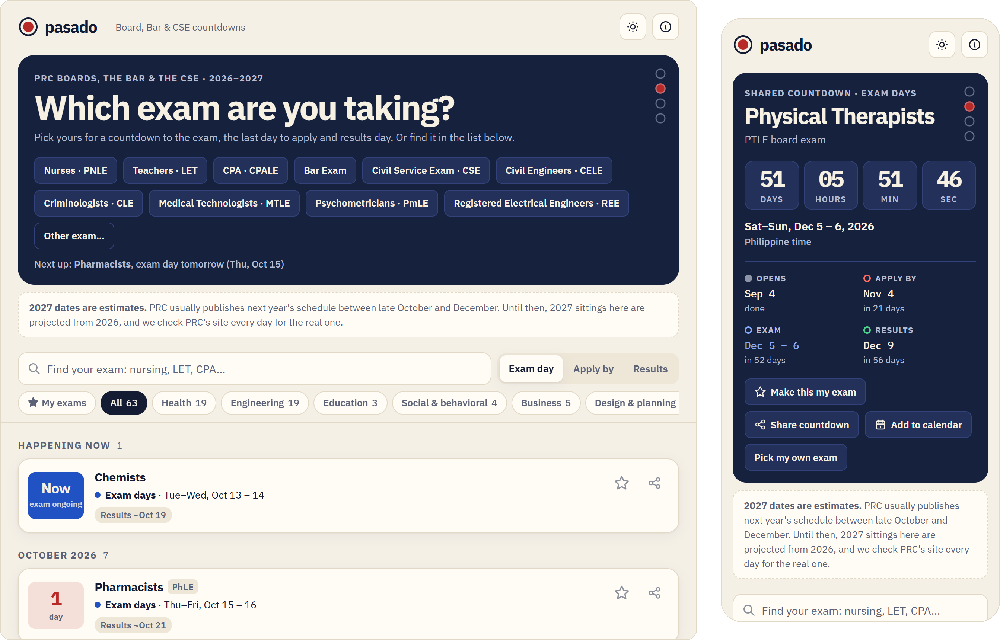

<p align="center">
  <a href="https://pasado.ruzcko.dev"></a>
</p>

<p align="center">
  <a href="https://pasado.ruzcko.dev"></a>
  <a href="https://pasado.ruzcko.dev"></a>
  <a href="#where-the-dates-come-from"></a>
  
</p>

# Pasado

Countdowns to every PRC board exam in the Philippines, plus the Bar and the Civil Service Exam: when applications open, the last day to apply, exam days and the target results date. Live at **[pasado.ruzcko.dev](https://pasado.ruzcko.dev)**.

<picture>
  <source media="(prefers-color-scheme: dark)" srcset="docs/screenshot-dark.png">
  
</picture>

- **Pick your exam** and get a live countdown, with the four dates that matter: applications open, apply by, exam days and results.
- **Share it.** Every exam has its own link (`/nurses`, `/cpa`, `/bar`) with a link preview, and a share card for Stories.
- **Add it to your calendar** with a feed per exam, which updates when PRC moves a date.
- **Next year's dates are estimated** until PRC publishes them, and marked as such everywhere.

> [!NOTE]
> Pasado isn't affiliated with PRC, the Supreme Court or the Civil Service Commission. Dates can change, so confirm on the official site before you apply.

## Where the dates come from

PRC publishes one HTML table per year at `https://www.prc.gov.ph/<year>-schedule-examination`
(index: `/exam-schedules-menu`). Each row has the exam, its dates, testing centers, the
application window, the target results date and links to the exam program and requirements.
Reschedules, cancellations and added testing centers are pasted into the cells as
"Resolution No. …" text with a link; we keep those as notices.

- `pipeline/prc.py` reads this year's and next year's pages and writes `data/prc/<year>.json`.
  The page is hand-edited Word HTML whose layout drifts between years, so the parser is
  forgiving but the checks are strict: if a table doesn't look like a schedule, it stops
  without writing and the scheduled job fails. Standard library only.
  It also keeps when a sitting's dates changed, so the page can say "moved".
- `data/exams.json` is the catalog: one entry per exam with a permanent `key` (used in links
  like `/nurses`), the names PRC has used for it, acronyms people search for (PNLE, LET, CPALE…),
  a category, and the title passers earn (RN, CPA, LPT, Engr.…) for share cards.
  A new exam PRC adds still shows up (under "Other") until it's added here.
- `data/overrides.json` holds manual corrections, by sitting id. Use sparingly.
- `data/other_exams.json` holds exams outside PRC, entered by hand: the **Bar exam** (Supreme
  Court Bar Bulletins) and the **Civil Service Exam** (CSC exam announcements). Each agency
  publishes only a few dates a year, so a scraper isn't worth it. Every sitting cites its
  source document; add next year's sitting when the agency announces it.
- `pipeline/build.py` (no network) turns the snapshots into `site/data/exams.json`,
  one calendar feed per exam (`site/cal/<key>.ics`, plus `<key>-sple.ics` for exams abroad)
  and the sitemap. Until PRC publishes next year's schedule, next year's sittings are
  **estimated** from this year's (same weekday, 52 weeks later) and marked as such;
  estimates never go into calendar feeds.

## Run locally

```bash
python pipeline/prc.py      # fetch and parse (or: python pipeline/prc.py --file page.html --year 2026)
python pipeline/build.py
python pipeline/dev.py      # http://localhost:8774, also answers /nurses like production
```

## Deploy (Cloudflare Pages)

- Pages project `pasado`, connected to this repo (branch `main`), custom domain `pasado.ruzcko.dev`.
- Build command: `python3 pipeline/build.py`. Output directory: `site`.
- `functions/` adds what static files can't: `/<exam>` routes and link previews (title,
  description and a 1200×630 countdown image from `functions/og.js`, drawn with resvg).
- `.github/workflows/schedule.yml` would read PRC twice a day and commit changes, but it's disabled:
  PRC refuses connections from GitHub's servers. For now, run `pipeline/prc.py` from a PC and push;
  the push rebuilds the site.
- The ruzcko.dev zone sets a 4-hour browser cache on static files, so Pages builds stamp
  `app.js`, `share.js` and `style.css` with `?v=<hash>`.

## Credits

Exam dates: PRC's public Schedule of Examinations (not affiliated with PRC).
IBM Plex Sans and Plex Mono (OFL 1.1), resvg-wasm (MPL-2.0). See `site/credits.html`.

## License

The code is [MIT](LICENSE). The fonts and resvg-wasm keep their own licences (above), and
exam dates belong to the agencies that publish them.
